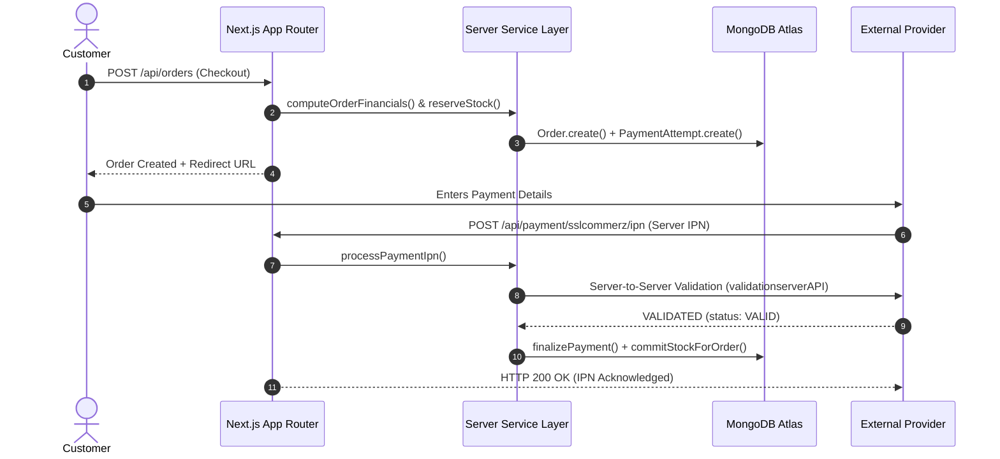

# Application Architecture — ANGKON

## 1. Directory & Codebase Layout

```text
src/
├── app/                        # Next.js 16 App Router Routes
│   ├── (storefront)/           # Customer facing pages: /, /products, /cart, /checkout
│   ├── account/                # Customer account pages: orders, tracking, profile
│   ├── admin/                  # Administrative UI: orders, payments, couriers, settings
│   │   ├── orders/             # Order management dashboard, drawer, filters, modals
│   │   ├── payments/           # Financial transactions, attempts, timeline, refunds
│   │   ├── courier/            # Logistics overview, Steadfast balance, presets
│   │   └── settings/           # Policy, courier, payment, and checkout configurations
│   └── api/                    # REST API Endpoints
│       ├── admin/              # Protected admin routes (requireAdminSessionCore)
│       ├── checkout/           # Checkout configuration & initiation
│       ├── cron/               # Scheduled tasks (reconciliation, meta-sync)
│       ├── payment/            # Customer payment callbacks & redirects
│       ├── payments/           # Admin payment actions (reconcile, refund, retry)
│       └── webhooks/           # Gateway & courier webhooks (SSLCOMMERZ, Steadfast)
├── components/                 # Shared UI & layout components
│   ├── admin/                  # Specialized admin components
│   └── ui/                     # Primitives (Radix UI, Tailwind CSS)
├── lib/                        # Infrastructure utilities (MongoDB connection, Cloudinary)
├── models/                     # Mongoose Schema definitions (Order, PaymentAttempt, Shipment)
├── server/                     # Domain business logic & external service adapters
│   ├── admin-auth.ts           # Admin session & HMAC token verification
│   ├── courier/                # Courier service, Steadfast adapter, Mock provider
│   ├── orders/                 # Order financial calculations, status transitions
│   ├── payments/               # Payment state machine, SSLCOMMERZ client, reconciliation
│   └── stock.ts                # Stock reserve, commit, and release lifecycle
└── types/                      # TypeScript shared interfaces
```

---

## 2. Request Lifecycle & Routing Architecture



---

## 3. Separation of Concerns & Service Layer Boundaries

1. **API Handlers (`src/app/api/**`):**
   - Strictly responsible for HTTP request parsing, rate limiting, authentication extraction, parameter validation, and formatting responses.
   - Delegates business logic to `src/server/**`.

2. **Domain Services (`src/server/**`):**
   - Pure, framework-agnostic business logic.
   - Contains business rules: financial formulas, courier eligibility, state machine transitions, and stock management.

3. **Data Access Layer (`src/models/**`):**
   - Mongoose schemas with indexed fields and schema invariants.
   - Repositories under `src/server/payments/repositories/` encapsulate database operations.
