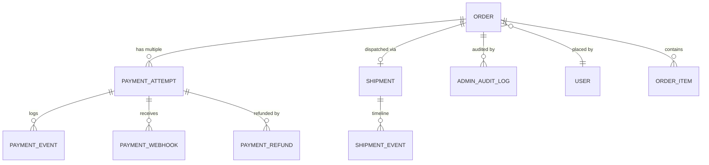

# Database Architecture — ANGKON

## 1. MongoDB Collections Overview

| Collection | Model File | Purpose | Primary Indexes |
|---|---|---|---|
| `orders` | `src/models/Order.ts` | Customer orders, item lists, customer info, order lifecycle | `orderNumber` (unique), `createdAt`, `orderStatus`, `paymentStatus`, `shipmentStatus` |
| `paymentattempts` | `src/models/PaymentAttempt.ts` | Detailed payment sessions, gateway transaction IDs, amounts | `tranId` (unique), `orderNumber`, `paymentStatus`, `createdAt` |
| `paymentevents` | `src/models/PaymentEvent.ts` | Immutable append-only event log for every state transition | `paymentId`, `tranId`, `orderNumber`, `createdAt` |
| `paymentwebhooks` | `src/models/PaymentWebhook.ts` | Incoming IPN & callback payloads with deduplication hash | `fingerprint` (unique), `tranId`, `status` |
| `paymentrefunds` | `src/models/PaymentRefund.ts` | Partial & full refund records, gateway refund refs | `refundId` (unique), `orderNumber`, `status` |
| `shipments` | `src/models/Shipment.ts` | Courier consignments, tracking codes, weight, courier timeline | `idempotencyKey` (unique), `consignmentId`, `trackingCode`, `orderNumber` |
| `courierlogs` | `src/models/CourierLog.ts` | Audit log of all courier HTTP requests and responses | `provider`, `orderNumber`, `createdAt` |
| `products` | `src/models/Product.ts` | Catalog items, sizes, colors, inventory stock, shipping weights | `id` (unique), `slug` (unique), `status` |
| `categories` | `src/models/Category.ts` | Hierarchical taxonomy (parent/child), navigation sort order | `id` (unique), `slug` (unique), `parent` |
| `users` | `src/models/User.ts` | Admin and customer accounts, authentication credentials | `email` (unique), `role` |
| `adminauditlogs` | `src/models/AdminAuditLog.ts` | Immutable trail of admin actions (bookings, overrides, refunds) | `targetId`, `action`, `createdAt` |
| `ratelimitbuckets`| `src/server/rate-limit.ts` | Distributed sliding-window rate limit counters | `key` (unique), `expiresAt` (TTL index) |

---

## 2. Entity Relationship Model

---

## 3. Data Integrity & Concurrency Controls

1. **Idempotency Keys:**
   * Shipment bookings enforce a unique compound key `${orderNumber}:${provider}`.
   * SSLCOMMERZ checkout requests enforce unique transaction identifiers `${orderNumber}-${attemptNumber}`.
2. **Atomic MongoDB Updates:**
   * Inventory commits use `$inc: { stock: -item.quantity }` with `{ stock: { $gte: item.quantity } }`.
   * Order locking uses `findOneAndUpdate` with status criteria to prevent race conditions during simultaneous webhook callbacks.
3. **Audit Trails:**
   * Financial states and courier operations append immutable event records (`PaymentEvent`, `CourierLog`, `AdminAuditLog`).
