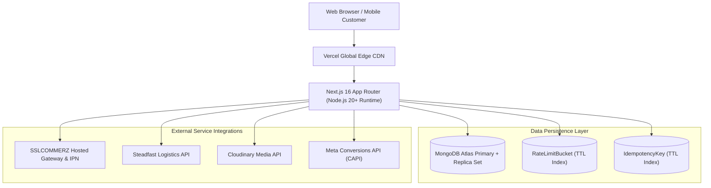

# System Overview — ANGKON

## 1. Architectural Mission
ANGKON is a luxury ethnic apparel e-commerce platform built to provide:
1. High-conversion storefront with rapid sub-second page loads.
2. Independent lifecycles for order fulfillment, payments, and courier logistics.
3. Resilient payment and courier operations that prevent duplicate financial charges or double bookings.
4. Zero Redis dependency by utilizing MongoDB atomic operators, TTL indexes, and strict idempotency keys.

---

## 2. High-Level System Architecture

---

## 3. Core Architectural Principles

### A. Three-Tier Status Separation
ANGKON enforces strict separation across business concerns:
* **Order Status (`orderStatus`):** `pending`, `confirmed`, `processing`, `ready_to_ship`, `shipped`, `delivered`, `completed`, `cancelled`, `returned`.
* **Payment Status (`paymentStatus`):** `unpaid`, `advance_pending`, `partially_paid`, `paid`, `failed`, `refund_pending`, `partially_refunded`, `refunded`.
* **Shipment Status (`shipmentStatus`):** `not_booked`, `booking_pending`, `booking_failed`, `booked`, `pickup_pending`, `picked_up`, `in_transit`, `out_for_delivery`, `delivered`, `delivery_failed`, `return_initiated`, `returned`, `cancelled`, `unknown`.

### B. Single-Commit Stock Reservation & Settlement
* Stock is reserved when checkout initiates.
* Stock is committed strictly once upon verified payment confirmation (`commitStockForOrder`).
* If an order is cancelled or times out, stock is released automatically (`releaseStockForOrder`).

### C. Server-Side Gateway Validation
* Client-side callbacks from SSLCOMMERZ are treated as unverified hints.
* Final payment confirmation only occurs after server-to-server validation via SSLCOMMERZ `/validator/api/validationserverAPI.php`.
* Duplicate IPN webhooks are deduplicated using SHA-256 event fingerprinting in `PaymentWebhook`.

### D. Multi-Mode Courier Architecture
* **Mock Mode (Default):** Zero external HTTP calls; deterministic IDs prefixed `MOCK-CID-` and `MOCK-TRK-`; simulated balance of ৳50,000 tagged `[MOCK]`.
* **Live Mode:** Real Steadfast API; requires explicit administrator confirmation (`confirmLiveBooking: true`); test orders (`isTestOrder`, dummy phone/email) are hard-blocked server-side.
