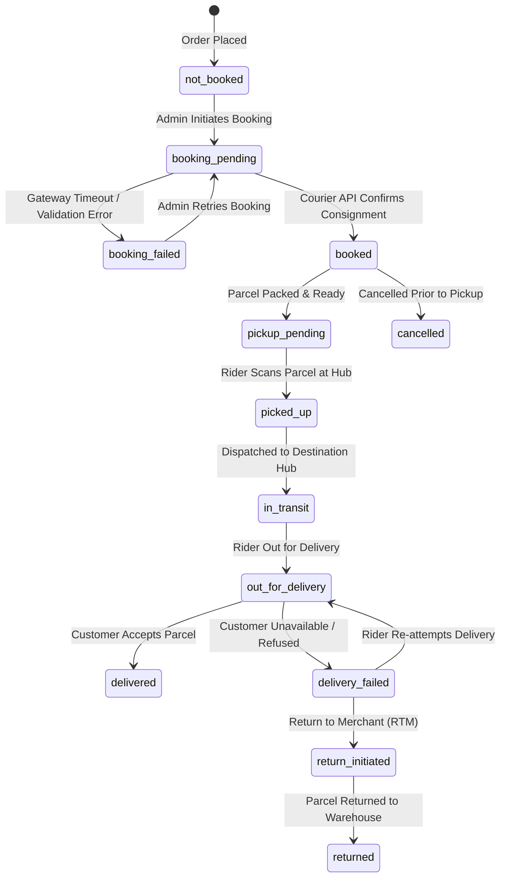

# Courier Lifecycle & Operations — ANGKON

## 1. Canonical Courier Lifecycle

ANGKON tracks courier status independently from internal order status:

---

## 2. Cash-on-Delivery (COD) Calculation Formulas

ANGKON computes COD strictly from server-side financials:

$$\text{Collectible COD} = \max(0, \text{Order Total} - \text{Verified Advance Paid})$$

* If order is **Fully Paid Online**: COD = ৳0 (Prepaid parcel).
* If order is **Partial Advance Paid**: COD = $\text{Total} - \text{Advance}$.
* If order is **Full COD**: COD = $\text{Total}$.

---

## 3. Order Status Synchronization Rules

1. When courier consignment is booked (`booked`):
   - Order transitions from `confirmed` / `processing` to `ready_to_ship`.
2. When courier physically picks up parcel (`picked_up`):
   - Order transitions to `shipped`.
3. When courier confirms delivery (`delivered`):
   - Order transitions to `delivered` (or `completed`).
4. When courier marks parcel returned (`returned`):
   - Order transitions to `returned`, and reserved stock is safely released back to catalog.
