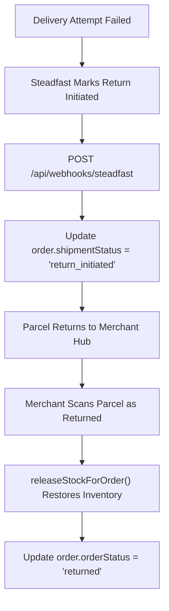

# Tracking & Returns Operations — ANGKON

## 1. Package Tracking Mechanisms

ANGKON provides 3 complementary tracking methods:

1. **Customer Public Tracking:**
   * Direct tracking URL: `https://steadfast.com.bd/t/<TRACKING_CODE>`.
   * Integrated customer order tracking page: `/account/orders/[orderId]`.

2. **Admin Real-Time Polling:**
   * Inside **Admin → Orders → Order Drawer**:
     - Displays live courier events history.
     - Includes a **"Refresh Tracking"** button that immediately queries Steadfast `/status_by_cid/{id}`.

3. **Automated Webhook Synchronization:**
   * Endpoint: `POST /api/webhooks/steadfast`.
   * Receives real-time parcel state updates from Steadfast delivery riders.
   * Signature verified via `STEADFAST_WEBHOOK_SECRET`.

---

## 2. Parcel Return Workflow

When a delivery cannot be completed (e.g. customer unavailable or refuses delivery):

---

## 3. Cancellation Policy

* **Before Pickup (`created` / `pending` / `in_review`):**
  - Admin clicks **"Cancel Consignment"** in the Shipment tab.
  - Providers **with** a cancellation API are called directly; a failed API call
    leaves the consignment active locally.
  - **Steadfast has no public cancellation API.** The admin cancels the parcel in
    the Steadfast portal, then clicks **"Mark cancelled (portal)"** and confirms.
    The local status is never changed without that confirmation.
  - The order itself cannot be cancelled while any consignment is active — cancel
    the consignment first, then cancel the order.
  - Reopening a cancelled order clears the order's courier summary but keeps the
    shipment history. Booking again creates a new consignment (the old one cannot
    be reactivated) and requires explicit confirmation.
* **After Pickup (`picked_up` / `in_transit`):**
  - Courier cancellation is locked via API.
  - Admin initiates Return to Merchant (RTM) through hub support with the Consignment ID.
