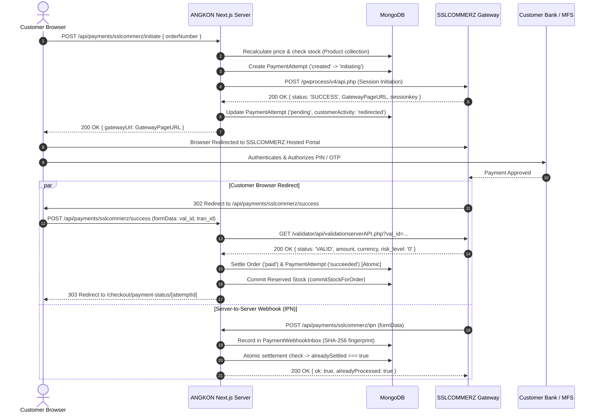
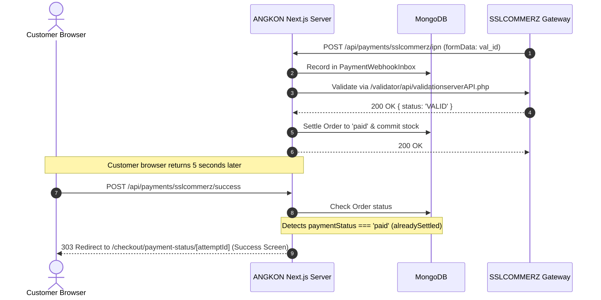
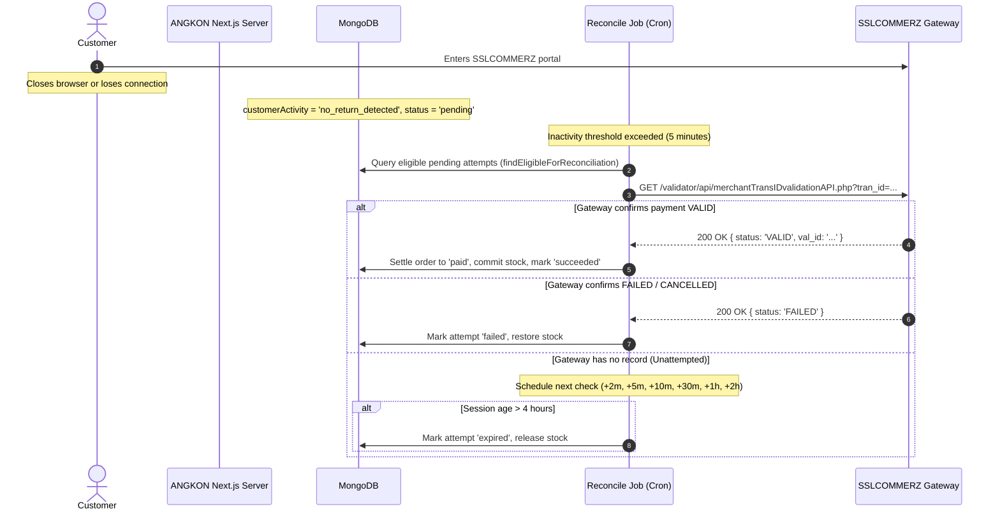

# ANGKON Payment Flows & Sequence Architecture

This document provides sequence diagrams and walkthroughs for the ANGKON payment integration with SSLCOMMERZ Hosted Gateway.

---

## 1. Happy Path: Online Payment Checkout & Confirmation

---

## 2. Early IPN Arrival Flow (IPN Arrives Before Customer Browser)

When network latency delays the customer's browser redirect:

---

## 3. Customer Abandonment & Internet Loss Recovery Flow

When the customer closes the browser tab or loses connection during checkout:

