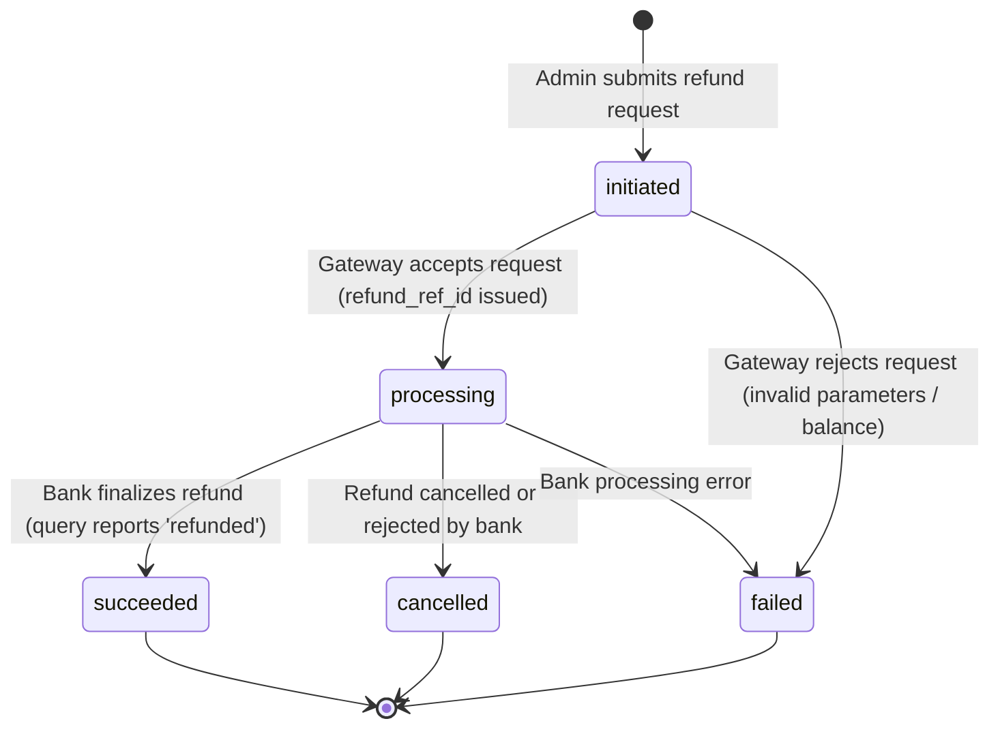

# Payment Refund Process & Lifecycle

This document specifies the refund architecture, business rules, and integration contracts for ANGKON.

---

## 1. Architectural Independence Axiom

As mandated by enterprise accounting rules, the system maintains three strictly independent financial records:

1. **`Order`:** Records overall commercial fulfillment status and aggregate refunded amount.
2. **`PaymentAttempt`:** Records the original payment charge. A successful attempt retains its original `succeeded` status (or moves to `partially_refunded` / `refunded`) to preserve the historical audit trail of the original capture.
3. **`PaymentRefund`:** Records each individual refund request, its unique gateway reference, execution timestamps, and reasons.

> **Critical Rule:** Submitting a refund request to SSLCOMMERZ does **not** mean money has been refunded. The refund is marked as `processing` until the gateway's Refund Status Query API confirms status `refunded`.

---

## 2. Refund Lifecycle State Machine



---

## 3. Validation & Over-Refund Prevention

Before initiating any refund:
1. The payment attempt must have `status === "succeeded"` or `"partially_refunded"`. (Unpaid, failed, or cancelled attempts can never be refunded).
2. The payment must have a valid `bankTranId` and `valId`.
3. The system aggregates all previous non-failed refunds for this payment attempt:
   ```ts
   alreadyRefunded = sum(PaymentRefund.find({ paymentId, status: { $in: ['processing', 'succeeded'] } }));
   availableBalance = attempt.expectedAmount - alreadyRefunded;
   ```
4. If `requestedAmount > availableBalance`, the request is rejected with HTTP 400 (`REFUND_AMOUNT_EXCEEDED`).

---

## 4. SSLCOMMERZ Refund API Calls

### 4.1 Initiate Refund
- **URL:** `https://sandbox.sslcommerz.com/validator/api/merchantTransIDvalidationAPI.php` (live: `https://securepay.sslcommerz.com/validator/api/merchantTransIDvalidationAPI.php`)
- **Method:** `GET`
- **Parameters:**
  - `store_id`: Store ID
  - `store_passwd`: Store Password
  - `bank_tran_id`: Original bank transaction ID from payment
  - `refund_amount`: Amount to refund
  - `refund_remarks`: Reason for refund
  - `refe_id`: Internal refund ID (`REF-...`)
  - `format`: `json`

### 4.2 Query Refund Status
- **URL:** Same as above
- **Parameters:**
  - `store_id`: Store ID
  - `store_passwd`: Store Password
  - `refund_ref_id`: Reference ID returned from initiation
  - `format`: `json`
- **Evaluations:**
  - `status: "refunded"`: Refund confirmed at bank. Marked `succeeded`.
  - `status: "processing"`: Under bank/MFS clearance.
  - `status: "cancelled"`: Refund cancelled. Marked `failed`.

---

## 5. Admin Portal Refund Operations

1. Navigate to `/admin/payments/[attemptId]`.
2. Scroll to the **Refund Lifecycle** card.
3. If the attempt has a positive refundable balance, the refund initiation form is active.
4. View past refund reference IDs, reasons, and clearance statuses in real time.
