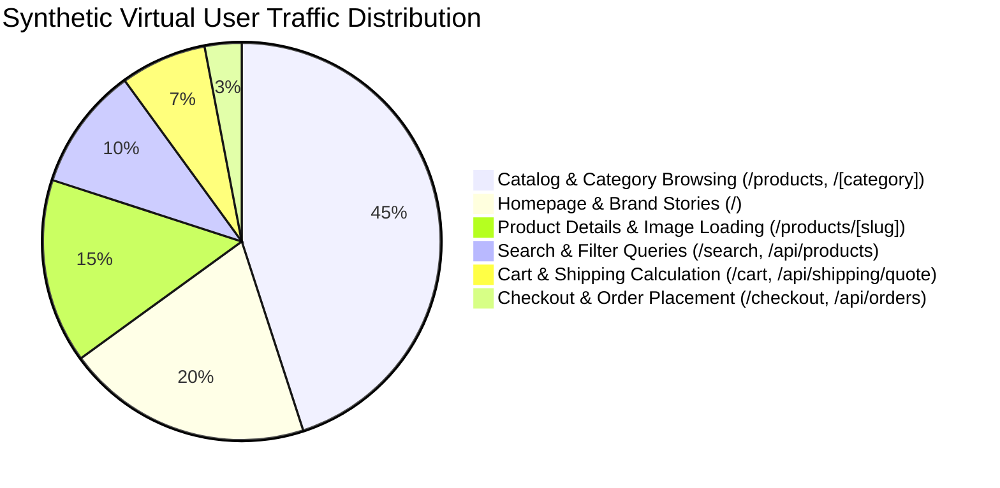

# Comprehensive Website Performance, Load, Security & Reliability Test Plan

**Project**: ANGKON Luxury Apparel E-Commerce Platform  
**Target Environment**: Node.js v24+ / Next.js 16.3.8 (App Router) + MongoDB Atlas + Cloudinary CDN  
**Auditor**: Senior QA Automation, Application Security, Performance & DevSecOps Engineer  
**Date**: October 2026  
**Status**: Phase 1 Completed — Formal Audit Plan & Architecture Assessment  

---

## 1. Executive Summary & Objective

The objective of this comprehensive audit and testing initiative is to evaluate the ANGKON e-commerce application for real-world production readiness, verifying its security posture against the **OWASP Top 10** and **OWASP ASVS**, measuring stability and response characteristics under progressive loads scaling up to **10,000 concurrent virtual users (VUs)**, and establishing rigorous automated regression coverage.

In accordance with Phase 1 directives:
- **Zero Destructive Changes**: No customer records, database collections, or live infrastructure have been modified or deleted.
- **Evidence-Based Evaluation**: Every finding and architectural assessment is rooted in concrete codebase inspection and verified execution paths.
- **Empirical Scale Reality**: Concurrency claims up to 10,000 VUs will be systematically evaluated through progressive load stages (Smoke → Baseline → Normal → Stress → Breaking Point) rather than assumed.

---

## 2. Architecture Discovery & Technology Stack

```mermaid
flowchart TD
    Client["Client Devices / Browsers"]
    EdgeCDN["Edge CDN / wsrv.nl Image Proxy"]
    NextServer["Next.js App Router (Port 3001)"]
    ProxyMW["proxy.ts Gateway Guard"]
    StorefrontRoutes["Storefront SSR & Static Routes (/, /products, /[category], /cart, /checkout)"]
    AdminRoutes["Admin Backoffice (/admin/*)"]
    PublicAPIs["Public & Auth APIs (/api/products, /api/orders, /api/auth/*)"]
    AdminAPIs["Protected Admin APIs (/api/admin/*)"]
    MongoDB[("MongoDB Atlas Database")]
    Cloudinary[("Cloudinary Asset CDN")]
    Resend[("Resend Email Service")]

    Client -->|Static Assets & Images| EdgeCDN
    Client -->|HTTPS Requests| NextServer
    NextServer --> ProxyMW
    ProxyMW -->|Pass| StorefrontRoutes
    ProxyMW -->|Pass| PublicAPIs
    ProxyMW -->|Verify nb_admin_token| AdminRoutes
    ProxyMW -->|Verify nb_admin_token| AdminAPIs
    StorefrontRoutes -->|Read Catalog (In-Memory Cache)| NextServer
    PublicAPIs -->|Queries & Rate Limits| MongoDB
    AdminAPIs -->|CRUD & Schemas| MongoDB
    AdminAPIs -->|Asset Management| Cloudinary
    PublicAPIs -->|Transactional Confirmation| Resend
```

### 2.1 Technology Stack Inventory

| Component | Technology | Version | Location / Config |
|---|---|---|---|
| **Frontend Framework** | React / Next.js (App Router, Turbopack) | React 19.2.6 / Next 16.3.8 | [`package.json`](file:///d:/Client%20Project/✅%20Agkon-New/package.json) |
| **Styling & UI** | Tailwind CSS, Radix UI, Framer Motion, Lucide | Tailwind 3.4.17 | [`tailwind.config.ts`](file:///d:/Client%20Project/✅%20Agkon-New/tailwind.config.ts) |
| **Database** | MongoDB Atlas via Mongoose ODM | Mongoose 9.11.1 | [`src/lib/mongodb.ts`](file:///d:/Client%20Project/✅%20Agkon-New/src/lib/mongodb.ts) |
| **Image CDN / Storage** | Cloudinary & wsrv.nl Resizing Proxy | Cloudinary SDK 2.11.0 | [`src/lib/cloudinary.ts`](file:///d:/Client%20Project/✅%20Agkon-New/src/lib/cloudinary.ts), [`src/lib/image-loader.ts`](file:///d:/Client%20Project/✅%20Agkon-New/src/lib/image-loader.ts) |
| **Email Gateway** | Resend API | Native HTTPS fetch | [`src/lib/email/resend.ts`](file:///d:/Client%20Project/✅%20Agkon-New/src/lib/email/resend.ts) |
| **Admin Authentication** | Custom HMAC-SHA256 Cookie (`nb_admin_token`) | Native Web Crypto API | [`src/proxy.ts`](file:///d:/Client%20Project/✅%20Agkon-New/src/proxy.ts), [`src/app/api/admin/login/route.ts`](file:///d:/Client%20Project/✅%20Agkon-New/src/app/api/admin/login/route.ts) |
| **Customer Auth** | Custom Scrypt + HMAC JWT (`angkon_user_token`) | Node.js `crypto` | [`src/server/auth.ts`](file:///d:/Client%20Project/✅%20Agkon-New/src/server/auth.ts) |
| **Rate Limiter** | MongoDB-backed sliding window counter | Custom model | [`src/server/rate-limit.ts`](file:///d:/Client%20Project/✅%20Agkon-New/src/server/rate-limit.ts) |
| **End-to-End Testing** | Playwright Test Suite | 1.64.0 | [`playwright.config.ts`](file:///d:/Client%20Project/✅%20Agkon-New/playwright.config.ts) |

---

## 3. Threat Model & Security Scope (OWASP WSTG & ASVS)

The security evaluation maps directly against the OWASP Top 10 (2021/2026) and ASVS Level 2 requirements:

### 3.1 Scope Matrix

| Vulnerability Category | Target Endpoints / Subsystems | Evaluation Criteria |
|---|---|---|
| **A01: Broken Access Control & IDOR** | `/admin/*`, `/api/admin/*`, `/api/auth/me`, `/api/orders` | Verify customer A cannot inspect or modify customer B orders; verify unauthenticated access to admin endpoints is completely blocked. |
| **A02: Cryptographic Failures** | Token signing, password hashing, session cookies | Audit secret fallbacks, HMAC algorithms, salt generation, and cookie flags (`httpOnly`, `secure`, `sameSite`). |
| **A03: Injection (SQL / NoSQL / Command)** | Mongoose queries across products, categories, orders, customers | Verify schema typing, `$where` / `$regex` sanitization, and query object parameter isolation. |
| **A04: Insecure Design & Business Logic** | Checkout price calculation, coupon discounts, guest checkout | Check for client-side price tampering, negative quantities, discount stacking, and account enumeration. |
| **A05: Security Misconfiguration** | `next.config.ts`, HTTP headers, CORS, error handling | Check CSP, HSTS, frame protection, detailed stack trace leakage in API responses. |
| **A06: Vulnerable & Outdated Components** | Dependencies in `package.json` | Audit known CVEs (Swiper prototype pollution, Next.js RCE, Axios DoS). |
| **A07: Identification & Auth Failures** | `/api/admin/login`, `/api/auth/login`, `/api/auth/reset-password` | Test brute-force protection, timing attacks, credential stuffing resistance, and token expiration. |
| **A08: Software & Data Integrity Failures** | Cloudinary uploads, image processing with `sharp` | Verify file type enforcement, prevention of malicious SVG/script payloads. |
| **A09: Security Logging & Monitoring** | Route handlers, auth failures, checkout errors | Audit audit trails, absence of sensitive data (passwords, tokens) in server logs. |
| **A10: Server-Side Request Forgery (SSRF)** | Cloudinary remote fetching, wsrv.nl image proxy loader | Validate external URL fetching constraints and proxy boundary rules. |

---

## 4. Architectural Bottlenecks & High-Concurrency Analysis (10,000 VUs)

During discovery, three major architectural bottlenecks were identified that directly impede scaling to 10,000 concurrent virtual users under the current deployment configuration:

### 4.1 Bottleneck 1: Database Connection Pool Starvation
- **Source**: [`src/lib/mongodb.ts`](file:///d:/Client%20Project/✅%20Agkon-New/src/lib/mongodb.ts#L54)
- **Code**: `maxPoolSize: 10` with a 5000ms global cooldown on connection failure (`FAILURE_COOLDOWN_MS = 5000`).
- **Impact at Scale**:
  - A maximum of 10 concurrent database operations can execute in parallel per Node.js process.
  - At 500–1,000 concurrent VUs, requests hitting dynamic endpoints queue behind the 10-connection ceiling.
  - If any connection drops under high load, line 48 triggers `throw new Error("MONGODB_CONNECTION_COOLDOWN")`, immediately rejecting **all subsequent requests for 5 seconds**.
- **Remediation Path**:
  - Dynamically tune pool size (`maxPoolSize: 100+` or serverless-adapted proxy like MongoDB Atlas Serverless / Prisma Accelerate).
  - Maximize edge caching for read-heavy routes (`/api/categories`, `/api/products`) so 95%+ of traffic never touches MongoDB.

### 4.2 Bottleneck 2: Database-Backed Rate Limiting Write Contention
- **Source**: [`src/server/rate-limit.ts`](file:///d:/Client%20Project/✅%20Agkon-New/src/server/rate-limit.ts#L22-L27)
- **Code**:
  ```ts
  await RateLimit.updateOne({ key, resetAt: { $lte: now } }, { $set: { count: 0, resetAt } });
  const doc = await RateLimit.findOneAndUpdate({ key }, { $inc: { count: 1 } }, { upsert: true, new: true });
  ```
- **Impact at Scale**:
  - Every rate-limited request executes two synchronous MongoDB write queries (`updateOne` + `findOneAndUpdate`).
  - High concurrency on login or checkout causes severe document-level lock contention on the `ratelimits` collection, rapidly consuming available database IOPS and exhaust connection pools.
- **Remediation Path**:
  - For 10,000 VU scale, rate-limiting must either use an in-memory sliding window cache (for single instances) or a Redis / Upstash Edge KV store with sub-millisecond atomic increments (`INCR` + `EXPIRE`).

### 4.3 Bottleneck 3: Synchronous Email Dispatch on Checkout
- **Source**: [`src/app/api/orders/route.ts`](file:///d:/Client%20Project/✅%20Agkon-New/src/app/api/orders/route.ts#L358-L381)
- **Code**: `await Promise.allSettled(emailTasks)` holds the HTTP response open until Resend API round-trips over the public internet (typically 300ms–1500ms).
- **Impact at Scale**:
  - Checkout request duration is inflated by 300%–500%, tying up Node.js server connections during peak traffic spikes.
- **Remediation Path**:
  - Offload email delivery to an asynchronous background worker or message queue (e.g. BullMQ / QStash / defer execution).

---

## 5. Staged Testing & Concurrency Roadmap

To safely evaluate performance without causing unmanaged failure, testing progresses through 7 strictly monitored tiers:

| Tier | Test Type | Concurrent VUs | Duration | Target Endpoints | Pass / Fail Criteria |
|---|---|---|---|---|---|
| **Tier 1** | **Smoke Test** | 1 – 5 | 2 mins | Home (`/`), Catalog (`/products`), API (`/api/categories`) | 100% success (0 errors), p95 < 250ms |
| **Tier 2** | **Baseline Test** | 10 – 50 | 5 mins | Storefront browsing + category filtering + cart add | 0 errors, p95 < 350ms, CPU < 40% |
| **Tier 3** | **Normal Load** | 100 – 200 | 10 mins | Full user flow: Browse, search, view product, shipping quote | Error rate < 0.1%, p95 < 500ms |
| **Tier 4** | **Medium Ramp** | 500 | 10 mins | Concurrent storefront + search + checkout validation | Error rate < 0.5%, p95 < 800ms |
| **Tier 5** | **Heavy Stress** | 1,000 | 10 mins | Mixed traffic (80% read, 15% search, 5% order placement) | Error rate < 1.0%, p95 < 1500ms |
| **Tier 6** | **Spike & Recovery** | 100 → 2,500 → 100 | 8 mins | Sudden traffic burst simulating flash sale / ad campaign | System recovers to baseline within 30s |
| **Tier 7** | **Target Max Load** | 5,000 – 10,000 | 15 mins | Progressive ramp to identify breaking point and bottleneck | Determine empirical max sustainable throughput |

### 5.1 Real-World User Scenario Weighting



---

## 6. Functional & Regression Test Matrix (Playwright Suite)

Automated test specs will be created and verified across the following functional domains:

| Spec File | Area | Tests Included |
|---|---|---|
| `e2e/auth-flow.spec.ts` | **Customer Authentication** | - User registration with validation<br>- Login with valid / invalid credentials<br>- Session persistence across page reloads<br>- Password reset link request and token handling<br>- Logout session invalidation |
| `e2e/admin-rbac.spec.ts` | **Admin RBAC & Security Gateway** | - Unauthenticated access to `/admin/dashboard` redirects to `/admin`<br>- Unauthenticated API calls to `/api/admin/*` return 401 JSON<br>- Invalid token manipulation is rejected<br>- Admin login with valid credentials succeeds and issues cookie |
| `e2e/checkout-security.spec.ts` | **Checkout & Business Logic** | - Authoritative server-side price verification (tamper rejection)<br>- District-based delivery fee computation<br>- Guest checkout flow and account linking logic<br>- Rate limiting triggers on rapid order floods |
| `e2e/catalog-navigation.spec.ts` | **Storefront & Catalog** | - Category hierarchy rendering<br>- Search query matching<br>- Out-of-stock and sale item badges<br>- Mobile navigation drawer responsiveness |

---

## 7. Safe Execution Boundaries & Data Isolation

1. **Synthetic Test Data Only**: All automated tests must use synthetic customer names (e.g. `qa_test_user_XXXX@example.com`) and mock addresses.
2. **Dedicated Test Database Prefix**: Test orders and users must carry identifiable test flags (`notes: "AUTOMATED_QA_TEST"`) for automated cleanup.
3. **No 3rd-Party Attack or Spam**:
   - Resend API email dispatch must be intercepted, mocked, or directed to verified test domains.
   - Cloudinary upload tests must isolate files in an `ANGKON/TESTING/` folder and invoke cleanup routines post-execution.
4. **Emergency Stop Conditions**:
   - If error rate exceeds 5% during any load test tier.
   - If response latency exceeds 10,000ms consecutively.
   - If host memory consumption exceeds 85%.

---

## 8. Verification & Acceptance Criteria

- [ ] All verified security findings (Critical to Low) documented with root-cause analysis in `docs/security/SECURITY-AUDIT.md`.
- [ ] End-to-end regression tests run cleanly with Playwright.
- [ ] Progressive load testing executed with empirical metrics (requests/sec, p50, p90, p95, error rates) documented in `docs/testing/PERFORMANCE-REPORT.md`.
- [ ] Confirmed vulnerabilities remediated, regression tested, and validated.
- [ ] Final executive summary delivered in `docs/testing/TEST-RESULTS.md`.
