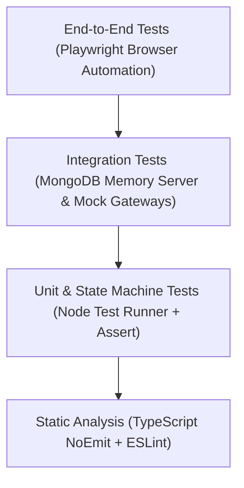

# Testing Strategy & Quality Gates — ANGKON

## 1. Multi-Tier Testing Pyramid

ANGKON enforces a strict multi-tier testing strategy:

---

## 2. Test Execution Commands

| Test Suite | Command | Coverage Target |
|---|---|---|
| Payment Suite | `npm run test:payments` | 45 tests covering full state machine, idempotency, refund |
| Workflow Suite | `npx tsx --test tests/orders-payment-courier-workflow.test.ts` | 30 tests covering 3-way status independence |
| Steadfast Modes | `npx tsx --test tests/steadfast-modes.test.ts` | 14 tests covering mock/live isolation & timeout recovery |
| Combined Runner | `npx tsx --test tests/payments/*.test.ts tests/*.test.ts` | Complete suite execution |
| Type Check | `npm run typecheck` | 0 errors across entire codebase |
| Lint Quality | `npm run lint` | 0 errors across all TypeScript & JSX files |

---

## 3. Mandatory CI Quality Gates

All automated Pull Requests and Release Candidates must pass:
1. `npm run typecheck`
2. `npm run lint`
3. Combined Node test runner (minimum 89 unit & integration tests)
4. `npm run build`
